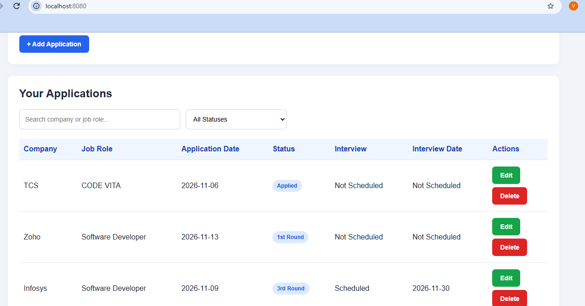
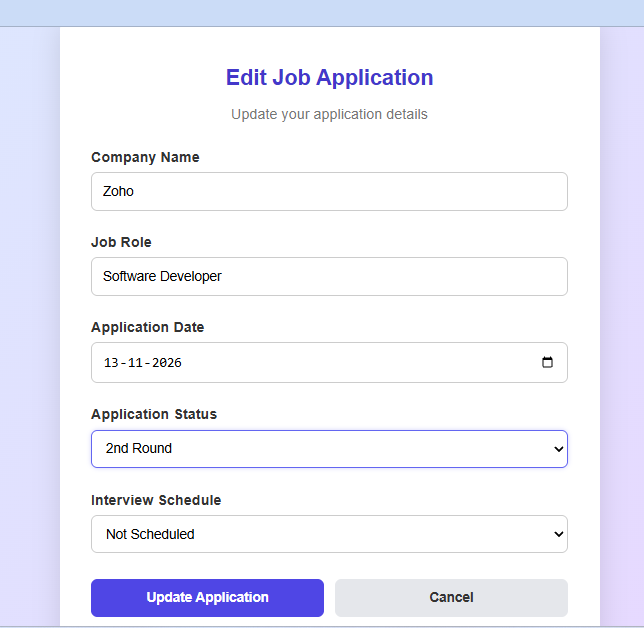

# Job Application & Interview Tracker

A Java-based web application built using Spring Boot that helps users manage job applications and track interview progress in one place.

## Project Evolution

This project was initially developed as a Java console application using JDBC and MySQL. It was later upgraded into a web application using Spring Boot, Spring Data JPA, Hibernate and Thymeleaf.

## Features

- Add new job applications.
- View all job applications.
- Update application details.
- Delete job applications.
- Track application status from Applied to 5th Round.
- Track interview status and interview dates.
- Dashboard displaying application statistics.
- Search applications by company name or job role.
- Filter applications by status.
- Form validation for required fields.
- Store application information in MySQL.

## Technologies Used

- Java 17
- Spring Boot
- Spring MVC
- Spring Data JPA
- Hibernate
- Thymeleaf
- HTML and CSS
- JavaScript
- MySQL 8
- Maven
- Git and GitHub

## Project Screenshots

### 1. Dashboard


### 2. Add Application



### 3. Edit Application



## Database Details

- Database: `jobtracker`
- Table: `job_applications`
- Database connectivity: Spring Data JPA and Hibernate.

## How to Run

### Prerequisites

- JDK 17 or later
- MySQL Server
- Visual Studio Code or another Java IDE

### 1. Clone the repository

```bash
git clone https://github.com/Vinusri-TRG/Java-Job-Application-Tracker.git
```

### 2. Create the database

Open MySQL and execute:

```sql
CREATE DATABASE jobtracker;
```

### 3. Configure database credentials

Set your MySQL credentials as environment variables in PowerShell:

```powershell
$env:DB_USERNAME="root"
$env:DB_PASSWORD="your_mysql_password"
```

Replace the password with your actual MySQL password.

### 4. Run the application

Open the project folder in the terminal and execute:

```powershell
.\mvnw.cmd spring-boot:run
```

### 5. Open the application

Visit:

http://localhost:8080

## Future Improvements

- User login and authentication.
- Online deployment.
- Cloud database integration.
- Additional dashboard features.

## Author

B.Sc. Information Technology Student